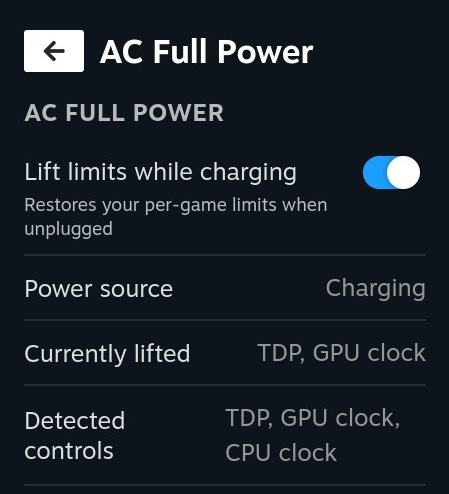

# AC Full Power

A [Decky Loader](https://decky.xyz/) plugin for the Steam Deck.



You set per-game TDP and GPU/CPU clock limits in the Steam Deck performance settings to save battery.
**AC Full Power** lifts those limits automatically while the Deck is charging (charger or powered dock), and puts your
exact values back when you unplug it.

**Nothing to configure.** The plugin does not ask for wattages or frequencies. It reads whatever limits
SteamOS has currently applied to the hardware and remembers them.

## How it works

Every 2 seconds the plugin checks the power source:

- **Charging detected** (any external power supply in `/sys/class/power_supply` is online; this includes a
  dock that is supplying power; a dock that only provides a display connection does not count):
  for every limit that is currently active, it saves the current value and sets the hardware maximum.
  - TDP: `power1_cap` / `power2_cap` → `*_cap_max` (hwmon)
  - GPU: manual clock range (`pp_od_clk_voltage`) → full `OD_RANGE`, performance level → `auto`
  - CPU: `scaling_max_freq` → `cpuinfo_max_freq`
- **Back on battery:** the saved values are written back.

If Steam re-applies a game profile while you are on the charger (for example after switching games), the
plugin notices and lifts that limit as well. Saved values are also stored on disk (tied to the current boot),
so nothing is lost if Decky restarts while a limit is lifted.

The quick access menu panel has an on/off switch and shows the power source and which limits are
currently lifted.

## Known limitations

- The limits are lifted on the hardware level. The switches and sliders in Steam's Performance tab are **not**
  changed, so they keep showing your profile even while the limits are lifted.
- Right after plugging in, Steam may briefly re-apply the profile before the plugin lifts it again.
- Only charging counts. A connected external display alone does not lift the limits. Tested with a charger and a powered dock.
- Tested on SteamOS only; the `sysfs` paths can vary between Deck models and SteamOS versions. The panel
  shows under "Detected controls" which of TDP / GPU / CPU were found.

## Install

### From a ZIP, pre-built

Download the .zip from https://github.com/braunglasrakete/steamdeck-decky-ac-full-power/releases/latest/download/ac-full-power.zip and install through developer options in Decky.

### From a ZIP, self-built

1. Build the plugin (see below) and zip the folder `ac-full-power/` containing `main.py`, `plugin.json`,
   `package.json` and `dist/index.js`.
2. On the Deck: Decky settings → Developer → enable developer mode → **Install plugin from ZIP**.

### Manual

Copy the folder with the same contents to `~/homebrew/plugins/` and restart Decky.

## Build

Requires Node.js and [pnpm](https://pnpm.io/).

```bash
pnpm install
pnpm build
```

This produces `dist/index.js`. The backend is plain Python (`main.py`) and needs no build step.

## Permissions

The plugin runs with root (`"flags": ["root"]` in `plugin.json`) because it writes to `/sys`.

## License

GPL-3.0-or-later, see [LICENSE](LICENSE).
